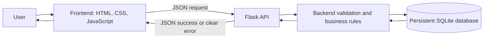

# School IT Help Desk — Design

## Purpose and scope

This Computer Science II prototype lets users create, view, search, filter,
assign, update, and resolve school IT support tickets. It uses Python/Flask,
SQLite, HTML/CSS, and JavaScript/JSON. Login accounts are out of scope: ticket
submission, dashboard, details, assignment, and status changes are accessible
without signing in. Use fictional data only; do not expose this prototype to a
public network.

## Architecture

- **Frontend:** Presents ticket forms, dashboard, filters, and details. It may
  provide immediate convenience validation but must not be trusted for
  correctness.
- **Flask backend:** Validates all input, enforces allowed values and status
  transitions, handles missing records and failures, and is the sole database
  access layer.
- **SQLite:** Stores persistent ticket, technician, and status-history records.
  Store its file outside publicly served static assets and use transactions for
  multi-record/multi-field changes.
- **Communication:** Browser JavaScript sends JSON over same-origin HTTP to
  Flask. Flask returns JSON; the interface reports success only after the
  server confirms the operation.

## Data model

All timestamps are UTC ISO 8601 values. Enable SQLite foreign-key enforcement
for every connection. Use parameterized SQL (or an equivalent safe data-access
layer).

### `technicians`

| Column | Type | Rules |
|---|---|---|
| `id` | TEXT | Primary key; stable fictional identifier |
| `name` | TEXT | Required, unique display name |

Seed a small fixed list of fictional technicians during database initialization.
Assignment accepts only an ID in this table. Login accounts are not part of
this design.

### `tickets`

| Column | Type | Rules |
|---|---|---|
| `id` | TEXT | UUID primary key, generated by the server |
| `room` | TEXT | Required, trimmed, non-empty |
| `device` | TEXT | Required, trimmed, non-empty |
| `category` | TEXT | Required; `Hardware`, `Software`, `Network`, or `Other` |
| `description` | TEXT | Required, trimmed, non-empty and meets approved minimum |
| `priority` | TEXT | Required; `Low`, `Medium`, or `High` |
| `status` | TEXT | Required; `Open`, `In Progress`, or `Resolved` |
| `created_at` | TEXT | Required; server-generated UTC timestamp |
| `updated_at` | TEXT | Required; server-generated UTC timestamp, updated on changes |
| `technician_id` | TEXT | Nullable foreign key to `technicians.id` |
| `resolution_notes` | TEXT | Nullable until resolution; required and non-blank when resolved |
| `resolved_at` | TEXT | Nullable until resolved; set by server on resolution |

Use database constraints as a second line of defense for category, priority,
status, and foreign-key validity. Application-level validation remains
authoritative for user-facing errors. On creation, the server supplies UUID,
timestamps, and `Open`; clients cannot override those fields.

### `ticket_status_history`

| Column | Type | Rules |
|---|---|---|
| `id` | INTEGER | Primary key |
| `ticket_id` | TEXT | Required foreign key to `tickets.id` |
| `old_status` | TEXT | Previous status |
| `new_status` | TEXT | New status |
| `changed_at` | TEXT | Server-generated UTC timestamp |

Insert a history row in the same transaction as each successful status change.
For resolution, update status, notes, `resolved_at`, `updated_at`, and history
atomically. If any write fails, roll back the entire operation. Existing
technician assignment remains unchanged when resolving.

## Business rules and validation

- Trim required text inputs; reject missing, non-string, empty, and
  whitespace-only values. Apply this to room, device, description, and
  resolution notes.
- Accept only the documented category, priority, and status values. Reject
  unsupported values in Flask even if browser controls are bypassed.
- Require a minimum description length. **Recommendation for Product Owner
  decision: 10 non-whitespace characters.** Do not silently treat this
  recommendation as approved; confirm it before implementation.
- Generate ticket UUID and timestamps on the server. Reject client attempts to
  supply or override server-owned fields.
- Validate the ticket ID format before lookup; return a clear not-found
  response for a well-formed ID without a matching ticket.
- Assignment must refer to a seeded technician. A null/unassigned value may be
  allowed to clear an assignment; invalid IDs must leave the saved assignment
  untouched.
- Allow only `Open` → `In Progress` → `Resolved`. Do not allow skipped or
  backward transitions or reopening a resolved ticket.
- Require non-empty resolution notes for the transition to `Resolved`. On
  success, set `resolved_at` and persist notes while retaining any existing
  technician assignment.
- Validation and operation failures must not partially change stored data.
  Return clear client-facing errors without SQL messages, stack traces, or
  internal paths. Log diagnostic details server-side.

## Suggested API

All API request and response bodies use JSON except page-serving routes.

| Method and path | Behavior |
|---|---|
| `GET /` | Serve the dashboard page |
| `GET /tickets/new` | Serve public ticket submission form |
| `GET /tickets/<ticket_id>` | Serve ticket details page; page obtains data through the API |
| `GET /api/technicians` | Return fictional technician IDs and display names |
| `GET /api/tickets` | List dashboard fields; optional `room`, `category`, `priority`, `status` query parameters combine as AND filters |
| `POST /api/tickets` | Validate and create ticket; server sets ID, timestamps, and `Open` status |
| `GET /api/tickets/<ticket_id>` | Return complete ticket details or a clear ID/not-found error |
| `PATCH /api/tickets/<ticket_id>/assignment` | Assign a listed technician or clear assignment if supported |
| `PATCH /api/tickets/<ticket_id>/status` | Apply an allowed transition; resolving requires notes |

Suggested response codes: `200`/`201` for success, `400` for invalid input or
transition, `404` for a missing ticket, and `500` for unexpected server or
database errors. Keep error JSON consistent, for example
`{"error":{"code":"validation_error","message":"...","field":"priority"}}`.
Never return a success response if a database operation failed.

## Development phases

Each phase requires an implementation plan, approved scope, test output, and
Product Owner QA before moving on.

At phase completion, record the approval decisions, errors encountered,
corrections, and actual test commands/results in `docs/ai-review-log.md`.
Review the phase changes and evidence, then commit and push the phase. Commits
preserve development history but are not proof of authorship or correctness.
Retain relevant AI conversation evidence if requested. Teacher review may
include explaining a function, tracing a browser-to-database request,
reproducing an error, or making a small change; the code must be understood and
pass tests. Do not substitute an unapproved one-shot build for phase-based
implementation and review.

1. **Foundation and persistent database:** Flask app skeleton, dependency and
   run instructions, SQLite initialization/schema, persistent database
   location, technician seed list, and database tests.
2. **Ticket creation and backend validation:** Public form/API, server-generated
   UUID/timestamps/status, required fields and enum validation, approved
   description minimum, clear errors.
3. **Dashboard, search, filters, and details:** Required dashboard columns,
   complete detail view, room search, category/priority/status filters and
   their combinations, malformed and nonexistent ID handling.
4. **Technician assignment:** Fictional technician picker, list endpoint,
   server validation, persistence, unassigned state, invalid-ID tests.
5. **Status and resolution:** Allowed transition sequence, rejection of
   invalid transitions/reopening, required resolution notes, timestamp,
   assignment retention, atomic status/history update.
6. **Integration and QA:** End-to-end and failure tests, data survival across
   restart, setup documentation, manual testing, known limitations.

## Acceptance tests

### Database and restart

- Initialize an on-disk database and seed technicians; repeated initialization
  does not duplicate seed entries or destroy tickets.
- Create and update a ticket, stop and restart the app, and verify data is
  still present.
- Force a database write failure and verify the API reports failure and no
  partial data is stored.

### Creation and validation

- Valid submission creates a unique ID, UTC creation/update times, and `Open`
  status without accepting client-supplied server-owned values.
- Missing, non-string, empty, or whitespace-only required fields are rejected
  with field-specific errors and no ticket is created.
- Unsupported category/priority and descriptions below the Product Owner
  approved minimum are rejected server-side.

### Dashboard, query, and details

- Dashboard shows ticket ID, room, device, category, priority, status,
  technician/unassigned value, and creation date.
- Room query and each category/priority/status filter work alone and in
  combination; results satisfy every supplied filter.
- Valid ticket ID returns details; malformed and nonexistent IDs return clear
  errors and do not crash the app.

### Assignment

- Assigning an existing fictional technician persists and is reflected in the
  dashboard and details.
- Clearing assignment produces the unassigned display if clearing is supported.
- Unknown technician IDs are rejected and do not change the prior assignment.

### Status and resolution

- `Open` → `In Progress` → `Resolved` succeeds and persists.
- Unsupported statuses, skipped/backward transitions, and reopening resolved
  tickets are rejected with no database change.
- Blank/missing resolution notes are rejected.
- Successful resolution saves notes, `resolved_at`, and `updated_at`, retains
  technician assignment, and records history atomically.
- A simulated failure during the resolution transaction rolls back every
  resolution/history change.

## Risks and decisions

- **No authentication:** Anyone with access can read or mutate tickets. Keep
  the prototype on a trusted local/classroom environment; authentication is
  needed before real deployment.
- **Description minimum:** Confirm the recommended 10 non-whitespace
  characters with the Product Owner before implementation.
- **Data handling:** Use only fictional records. Do not commit the database or
  real student/staff information.
- **SQLite concurrency:** This is suitable for a small prototype, not a
  high-write production service; keep write transactions short.
- **Database location and backup:** Phase 1 should document the actual local
  persistent path and how to reset development data safely.
